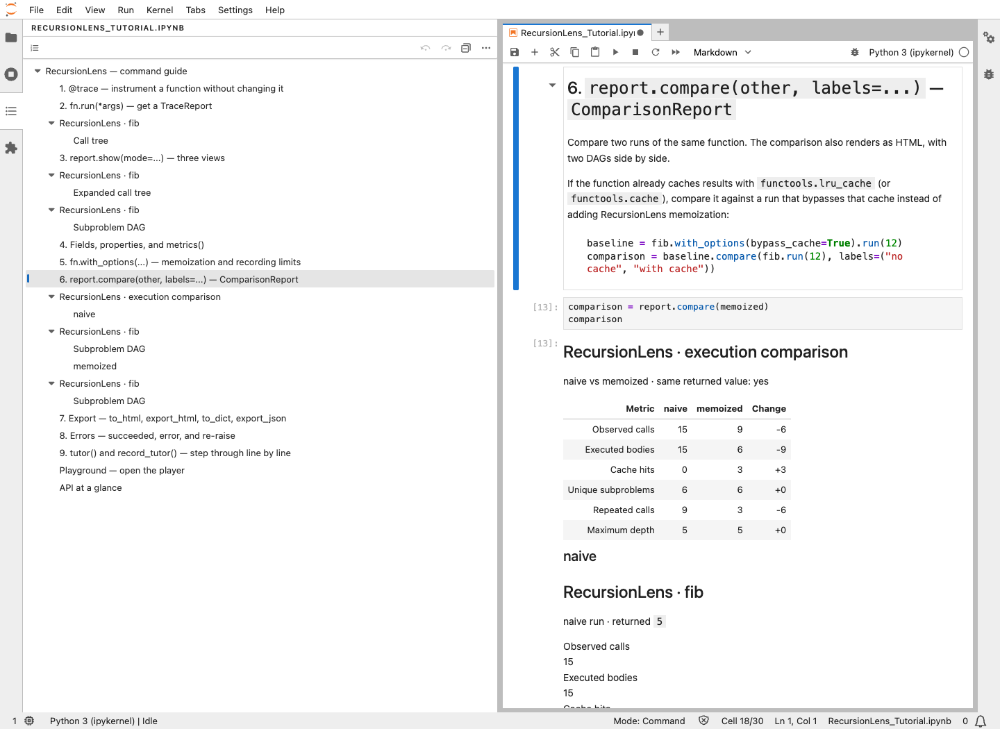
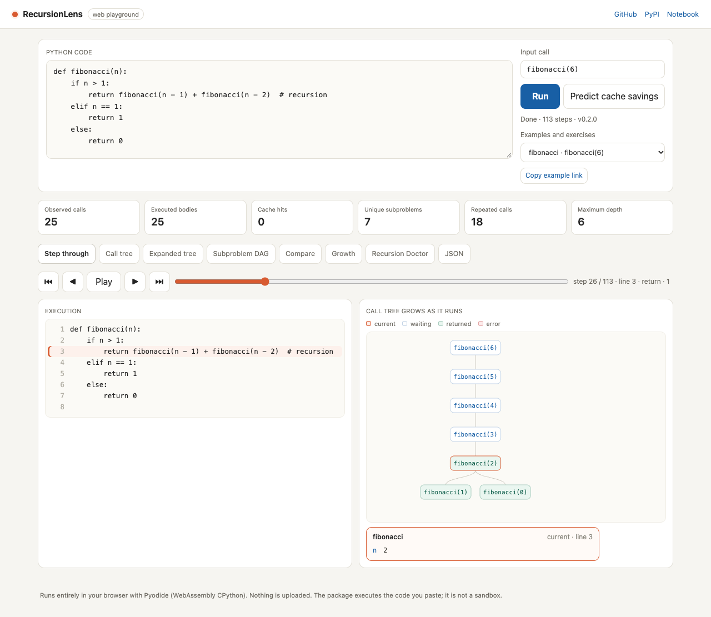

# RecursionLens

[English](https://github.com/ZiyuJiang07/recursionlens/blob/main/README.md) | **简体中文**

**不只看递归返回了什么，还要看到重复计算发生在哪里。**

[在浏览器中打开 RecursionLens](https://ziyujiang07.github.io/recursionlens/)。网页用 Pyodide 运行 CS1302A 课程示例，无需安装。你可以查看调用路径和 Recursion Doctor 的诊断依据，也可以[预测记忆化能省多少次计算](#预测记忆化能省多少次计算)。[浏览器操作指南](#在浏览器里追踪一次调用)

RecursionLens 是一个零运行时依赖的 Python 包，用于在 JupyterLab 中观察递归执行过程。它把一次追踪转换成可展开的调用树、压缩后的子问题 DAG，以及 naive 与 memoized 的定量对比。

> **已执行的 JupyterLab 教程：** [打开 RecursionLens_Tutorial.zh-CN.ipynb](https://github.com/ZiyuJiang07/recursionlens/blob/main/docs/RecursionLens_Tutorial.zh-CN.ipynb)（[English version](https://github.com/ZiyuJiang07/recursionlens/blob/main/docs/RecursionLens_Tutorial.ipynb)）。16 个代码单元已保存输出；最后一格在活内核中运行后会打开交互式播放器。如果 Jupyter 因为 notebook 未受信任而隐藏 HTML/SVG，点击 **Trust**，或执行一次 **Run All Cells**。想零配置预览，可以直接下载并打开[静态 HTML 版教程](https://github.com/ZiyuJiang07/recursionlens/raw/main/docs/RecursionLens_Tutorial.zh-CN.html)或[英文版](https://github.com/ZiyuJiang07/recursionlens/raw/main/docs/RecursionLens_Tutorial.html)。

## 界面截图

**JupyterLab —— 执行对比。** `report.compare()` 直接在 notebook 里渲染指标表与两侧 DAG，可以看出执行了多少次函数体、有多少次调用由缓存直接返回。



**网页版 —— 逐行播放器。** 调用树随着代码执行逐步长大：已经返回的调用留在树上变成绿色，当前调用是珊瑚色，当前帧的局部变量显示在树下方。



## 项目团队

CS1302A Group 50：

- Ziyu JIANG
- Xinyue CAI
- Kehan CAO
- Ruoxi LYU
- Haobo MA

## 为什么需要 RecursionLens？

RecursionLens 起源于一个初学者学递归时的真实困难。循环可以一行行读下去，但非尾递归的调用（比如 `fib`、树的遍历）会展开成大量交错的调用：同一个子问题被反复进入，返回值要等整棵子树算完才回来。课程提供的单步执行工具（OPT）对普通程序很有帮助，它一次显示一个执行步骤；可一旦进入递归，看到的就是一长串压栈、出栈的步骤，既看不出这次计算整体的形状，也看不出哪些子问题在重复，最后往往还是得拿笔在纸上画调用树。RecursionLens 就是把这张手绘图自动化，并补上手画不出来的数字。

它回答三个不同的问题：

1. **调用树：** 逐次调用来看，到底发生了什么？
2. **子问题 DAG：** 合并相同参数之后，真正有多少个不同的子问题、它们如何依赖？
3. **执行对比：** 开启 memoization 之后，哪些指标发生了变化？

以 `fib(5)` 为例，整个过程是 **观察到 15 次调用 → 6 个唯一子问题 → memoization 后只执行 6 次函数体**。

## 相比调用图的新意

现有 `rcviz` 包已经能画出基于装饰器的递归树，包含参数、返回值和 Jupyter 渲染。RecursionLens 有意聚焦另一条工作流：

- 在同一份 trace 上，在调用树与压缩子问题 DAG 之间转换；
- 一次性用 SVG 展示完整调用树，或在较大的运行中保留可折叠树；
- 量化重复调用、实际执行次数、缓存命中与最大深度；
- 在一份报告中并排对比 naive 与 memoized 的 DAG；
- 在 JupyterLab 中渲染自包含的 HTML/SVG，不需要 Graphviz、原生库、外部 JavaScript 或 CDN；
- 导出带版本号的 JSON，便于复现分析与测试。

## 安装

RecursionLens 需要 Python 3.9 或更高版本。

从 PyPI 安装：

```bash
python -m pip install recursionlens
```

本地开发：

```bash
git clone https://github.com/ZiyuJiang07/recursionlens.git
cd recursionlens
python -m pip install -e ".[dev]"
```

包没有运行时依赖。唯一可选的部分是交互式播放器，它需要 `ipywidgets`。

## JupyterLab 快速开始

```python
from recursionlens import trace

@trace
def fib(n):
    if n < 2:
        return n
    return fib(n - 1) + fib(n - 2)

naive = fib.run(5)
naive  # 在 notebook 输出区显示可展开的调用树
```

把同一份 trace 切换成压缩子问题 DAG：

```python
naive.show(mode="dag")
```

或者一次性展开全部调用，画成一张紧凑的 SVG 树，不折叠任何节点：

```python
naive.show(mode="expanded")
```

开启 memoization 再运行一次，并对比证据：

```python
memoized = fib.with_options(memoize=True).run(5)
comparison = naive.compare(memoized)
comparison
```

对比会确认两者返回值一致，并报告实测变化，其中包括 **函数体执行次数由 15 降到 6**。

函数原本的行为不受影响：

```python
assert fib(5) == 5
assert fib.last_report.total_calls == 15
```

## 逐行单步执行

0.2.0 版本新增了一个 Python Tutor 风格的播放器，直接在 notebook 里运行。粘贴一个函数、写好要执行的调用，就可以一步一步走：

```python
from recursionlens import tutor

tutor()   # 可编辑的代码面板、调用输入框、步进控件
```

播放器会高亮当前执行的行，并随着执行逐步长出调用树：等待中的调用是蓝色，正在执行的是珊瑚色，已经返回的会保留在树上并变成绿色；当前帧的局部变量显示在树的下方。改动调用（例如 `fib(5)` → `fib(3)`）会重新记录一次运行，并从根节点重新生长。每一步都会标明这是调用、普通行、返回还是异常，递归的进出顺序因此很容易看清。

播放器会以正常 Python 语义执行你粘贴的代码，它不是沙箱。

`tutor()` 需要 `ipywidgets`：

```bash
python -m pip install "recursionlens[tutor]"
```

记录过程本身是纯 Python，不用控件也能用：

```python
from recursionlens import record_tutor

trace = record_tutor("def fib(n): ...", "fib(5)")
print(trace.describe())
trace.steps[0].frames        # 某一步的栈帧快照
```

## 在浏览器里追踪一次调用

[打开在线演示](https://ziyujiang07.github.io/recursionlens/)，等默认示例 `fib(5)` 的运行记录加载完成。

在 **Step through** 点 **Play**，就能看调用树随执行逐步展开。点 **Pause** 可查看当前栈帧，也可以拖动进度条跳到指定步骤。

1. 打开 **Expanded tree**（展开的调用树），点一个 `fib(2)` 节点。右侧 **Trace inspector** 会显示完整调用路径，其中一条是 `fib(5) → fib(4) → fib(3) → fib(2)`。在 **Call tree**（调用树）中，也可以点调用旁的 **Inspect**。
2. 点 **Show in DAG**。三次 `fib(2)` 调用会合并成一个子问题节点。在 **Recorded calls** 中选一次调用，就能跳回它在调用树里的位置。
3. 打开 **Recursion Doctor**（递归诊断），找到 `fib(2)` 重复计算的提示，点 **Show call** 查看调用树上的证据。

诊断基于本次输入下已记录的调用。如果某个子问题还没返回就再次被调用，可以检查停止条件和传给递归调用的参数。若函数的结果只由参数决定且没有副作用，可以用记忆化来对比跨分支的重复计算。

在 **Examples and exercises** 里选 **Debug a base case**。打开 **Recursion Doctor**，点 **Show call** 沿调用路径找到报错的 `reciprocal_sum(n=0)`。把递归出口改成返回 `0`，再运行一次验证。[打开排错练习](https://ziyujiang07.github.io/recursionlens/?example=debug-base-case)

要分享内置练习，在 **Examples and exercises**（示例与练习）里选中一个练习，再点 **Copy example link**。打开链接会加载练习原有的代码和输入。编辑代码或输入后，重新选择内置练习即可复制链接。[打开网格路径练习](https://ziyujiang07.github.io/recursionlens/?example=grid-paths)

要预览本地版本，在仓库根目录运行 `python -m http.server 8000`，然后打开[本地演示](http://localhost:8000)。

## 预测记忆化能省多少次计算

1. 使用默认示例 `fib(5)`，或在 **Examples and exercises**（示例与练习）里选 **Grid paths**，加载 `paths(3, 3)`。
2. 点 **Predict cache savings**，输入你预计开启记忆化后少执行的函数体次数。
3. 点 **Run and check**。**Compare** 会显示你的预测和实测结果，包括两次运行各执行了多少次函数体，以及缓存被命中了几次。

两次运行均成功且返回值一致时，网页会核对预测。请选择本身没有缓存、结果只取决于参数且没有副作用的函数。网格路径中，向右和向下的顺序可以不同，却可能剩下相同的步数。

<details>
<summary>查看网格路径的结果</summary>

`paths(3, 3)` 返回 20 条路径。开启记忆化后，实际执行函数体的次数从 39 次降到 15 次，省了 24 次，共命中缓存 4 次。

</details>

## 对比输入变大时的执行次数

在网页演示中打开 **Growth**，选择 **fibonacci** 或 **Grid paths**。两条曲线显示开启记忆化前后的实测函数体执行次数。每个输入大小都各自从头运行，点 **Exact counts** 可查看每组输入和对应次数。

Fibonacci 的输入从 1 到 12。运行 `fibonacci(12)` 时，开启记忆化后，执行次数从 **465 次降到 13 次**。网格路径比较两边等长的网格，边长从 0 到 6。运行 `paths(6, 6)` 时，执行次数从 **1,847 次降到 48 次**。[打开网页演示](https://ziyujiang07.github.io/recursionlens/)

## 导出报告

在 **Growth** 点 **Download CSV**，可把各组输入和实测次数保存到表格中。在 **JSON** 点 **Download JSON**，可保存当前运行的追踪报告。

```python
naive.export_html("fib-tree.html")
naive.export_html("fib-dag.html", mode="dag")
naive.export_json("fib-trace.json")
comparison.export_html("fib-comparison.html")
```

HTML 报告是独立文件，不需要 notebook 服务器就能打开。JSON 包含调用树、DAG 节点与边、指标、警告以及 schema 版本。

## 适用范围

0.2.0 版本面向同步、确定性的教学示例，例如阶乘、斐波那契和纯数学递归。

- memoization 要求绑定参数可哈希；参数不可哈希时给出警告，而不是崩溃。
- 对有副作用或依赖外部状态的函数，相同参数并不一定意味着重复劳动。
- `max_calls` 限制调用树保存的节点数。报告会统计整次运行的观察调用数、函数体执行次数和缓存命中次数。发生截断时，调用树与 DAG 的指标只基于已记录的节点。
- RecursionLens 会真实执行你的函数，**它不是运行不可信代码的沙箱**。
- 异步函数、生成器、自动推断 Big-O、自动改写代码，都不属于 0.2.0 的范围。

## 文档与示例

- [命令手册（简体中文）](https://github.com/ZiyuJiang07/recursionlens/blob/main/docs/RecursionLens_Tutorial.zh-CN.ipynb) — 每个公开命令一个示例：装饰器、报告对象、三种视图、指标、memoization、对比、导出与错误处理
- [Command guide (English)](https://github.com/ZiyuJiang07/recursionlens/blob/main/docs/RecursionLens_Tutorial.ipynb) — the same guide in English
- [静态 HTML 预览](https://github.com/ZiyuJiang07/recursionlens/raw/main/docs/RecursionLens_Tutorial.zh-CN.html) — 中文，不需要 Jupyter
- [Static HTML preview](https://github.com/ZiyuJiang07/recursionlens/raw/main/docs/RecursionLens_Tutorial.html) — English, no Jupyter required
- [可直接运行的示例 notebook](https://github.com/ZiyuJiang07/recursionlens/blob/main/examples/demo.ipynb)

## 开发与测试

```bash
python -m pytest tests -v
python -m build
python -m twine check dist/*
```

测试覆盖 trace 不变量、缓存行为、签名、异常、截断、JSON、HTML 转义、DAG 渲染与对比报告。贡献时应保持公共 API、测试与 README 同步。

文档保持双语：`README.md` / `README.zh-CN.md` 与 `docs/RecursionLens_Tutorial.ipynb` / `docs/RecursionLens_Tutorial.zh-CN.ipynb` 必须同时更新，包括各自生成的 HTML。

## 许可证

MIT © 2026 Ziyu JIANG、Xinyue CAI、Kehan CAO、Ruoxi LYU、Haobo MA。
